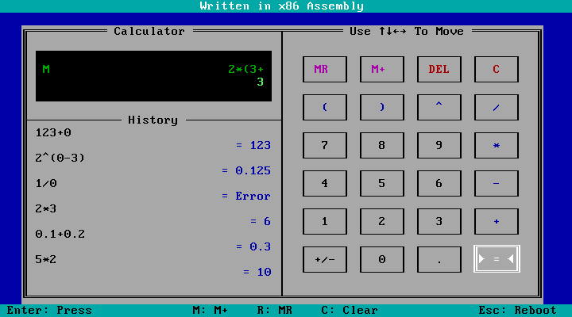
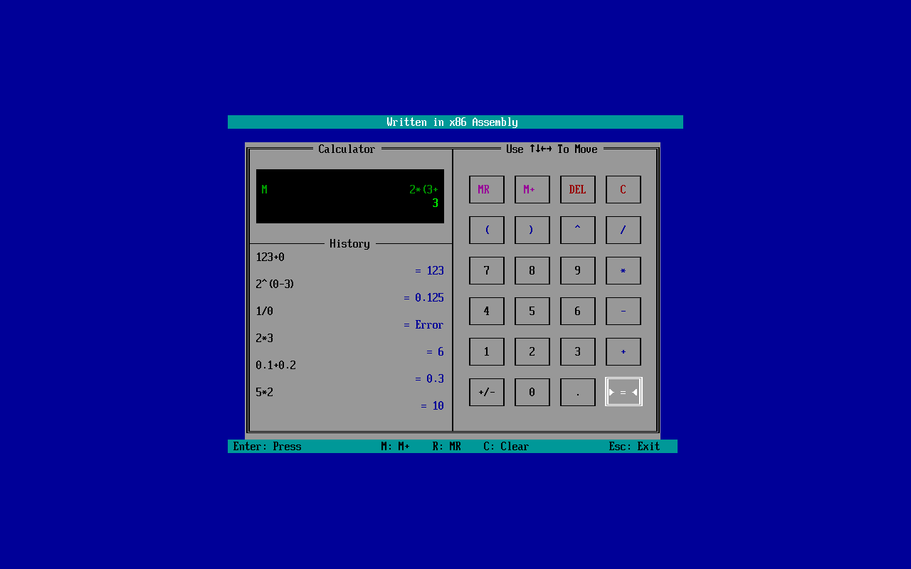

# x86 Firmware Calculator





A firmware-setup-style calculator written entirely in x86 assembly (NASM).
It boots directly, with no operating system, on:

| Machine                                   | What runs                 |
|-------------------------------------------|---------------------------|
| BIOS PC, 32-bit or 64-bit CPU (386 + FPU or later) | 16-bit real-mode build in the boot sectors |
| 64-bit UEFI PC                            | `EFI/BOOT/BOOTX64.EFI`    |
| 32-bit UEFI PC (some tablets, old Macs)   | `EFI/BOOT/BOOTIA32.EFI`   |

All three are in one disk image, `build/calc.img`, and share the same
calculator source (`src/core.inc`).

## Keys

```
 MR   M+   DEL   C
 (    )    ^     /
 7    8    9     *
 4    5    6     -
 1    2    3     +
 +/-  0    .     =
```

- Arrow keys move the highlight, Enter or Space presses the highlighted key.
- Or type directly: `0-9 . + - * / ^ ( )`, `=` for the result, Backspace or
  Delete for `DEL`, `C` to clear, `N` for +/-, `M` for M+, `R` for MR.
- Esc exits (BIOS: reboots; UEFI: returns to the firmware boot manager).

## Behaviour

- Normal precedence: `^` before `* /` before `+ -`; `^` groups right to left
  (`2^3^2` is 512). Brackets nest up to 8 deep; `=` closes any left open.
- `^` is the power key: `9^0.5` is a square root, `8^(1/3)` a cube root. A
  negative base needs a whole-number exponent.
- `M+` adds the displayed value to memory, `MR` recalls it, and an `M` shows in
  the display while memory is not zero. To clear memory: `MR`, `+/-`, `M+`.
- `C` clears the current calculation but keeps memory and the tape.
- One frame holds everything: on the left the display and, below it, a history
  of the last 6 calculations, newest first; on the right the keys.
- Numbers hold up to 12 digits before the decimal point and 6 after. Division
  by zero, an invalid power and overflow show `Error`.

## Build

Needs `nasm` and `mtools`.

```bash
./build.sh
```

## Run in QEMU

BIOS:

```bash
qemu-system-i386 -drive format=raw,file=build/calc.img
```

64-bit UEFI (path to OVMF varies by distribution):

```bash
qemu-system-x86_64 -bios /usr/share/ovmf/OVMF.fd -drive format=raw,file=build/calc.img
```

## Run on a real PC

Write the image to a USB stick (this erases the stick; replace `/dev/sdX`):

```bash
sudo dd if=build/calc.img of=/dev/sdX bs=1M conv=fsync
```

Then boot from it. On UEFI machines Secure Boot must be off, because the
program is not signed. Alternatively copy `BOOTX64.EFI` to `EFI/BOOT/` on any
FAT-formatted USB stick.

## Files

- `src/core.inc`  calculator logic and drawing, assembled for 16, 32 and 64 bit
- `src/data.inc`  strings, button table, variables
- `src/bios.asm`  boot sector and BIOS platform layer (VGA text memory, int 16h)
- `src/uefi.asm`  hand-written PE header and UEFI platform layer (text in/out protocols)
- `build.sh`      assembles everything and builds the disk image
